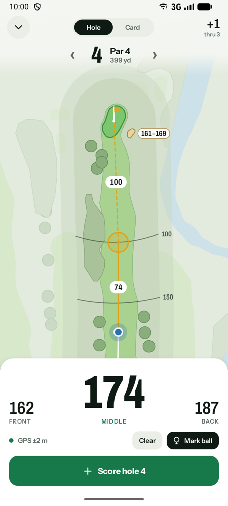
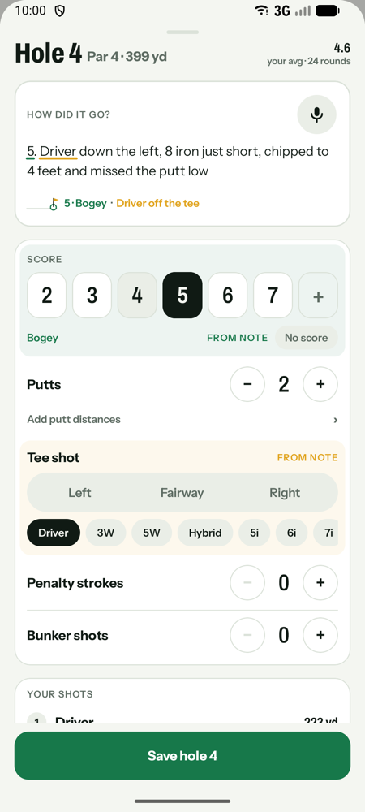
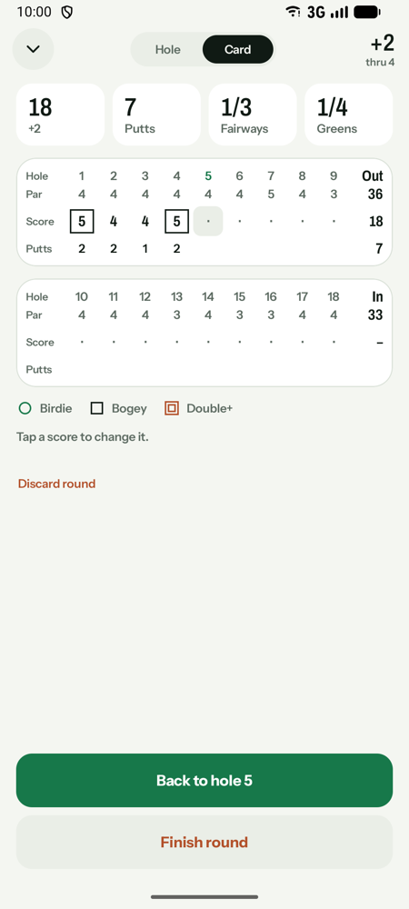
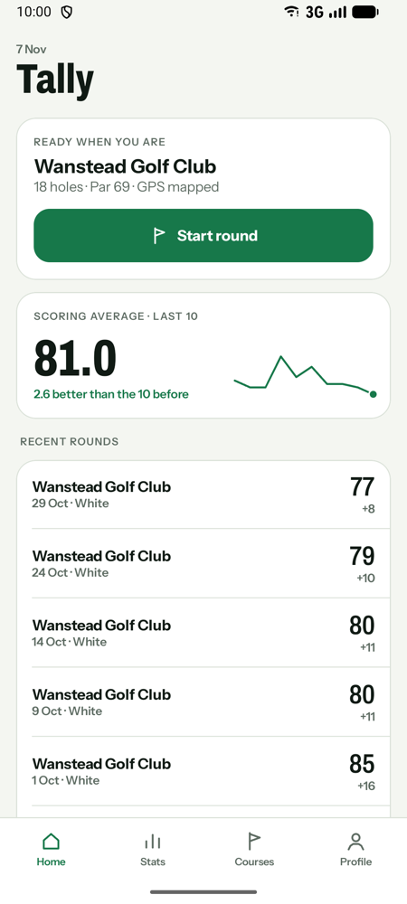
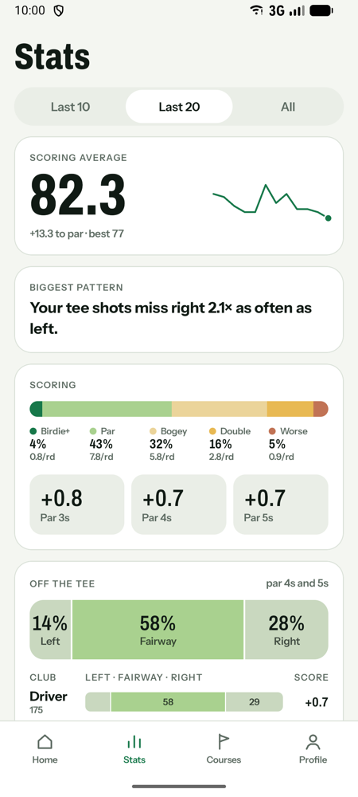
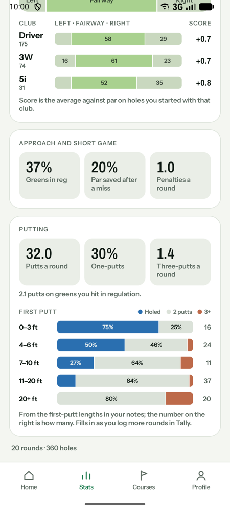

# Tally

A golf scoring app: GPS yardages on OpenStreetMap hole maps, and hole notes (typed or spoken) that AI
reads into your scorecard. Built with Kotlin Multiplatform and Compose Multiplatform; Android first,
iOS compiling.

<table>
  <tr>
    <td></td>
    <td></td>
    <td></td>
  </tr>
  <tr>
    <td align="center">GPS yardages and hazards on every hole</td>
    <td align="center">Say or type how it went; the card fills itself in</td>
    <td align="center">The card as you go</td>
  </tr>
  <tr>
    <td></td>
    <td></td>
    <td></td>
  </tr>
  <tr>
    <td align="center">Your rounds at a glance</td>
    <td align="center">The pattern that costs you most</td>
    <td align="center">Tee shots by club and putting by length</td>
  </tr>
</table>

<sub>Screenshots use made-up demo rounds.</sub>

## Building

- Android: `./gradlew :androidApp:assembleRelease`
- iOS: open `iosApp` in Xcode.
- Tests: `./gradlew :shared:testAndroidHostTest`

Online note reading uses the Gemini API. Put your own key in `local.properties` (never committed):

```
GEMINI_API_KEY=...
```

Without a key, notes are read on the phone with Gemini Nano where available.

## Note-reading evals

`evals/run-note-evals.sh` scores the note reader against `evals/note-evals.jsonl`. It calls the
Gemini API, so it uses your quota.

## Data and licences

Course data is © OpenStreetMap contributors (ODbL). Fonts are under the SIL Open Font License. See
[NOTICE.md](NOTICE.md).
